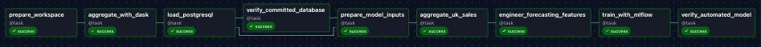
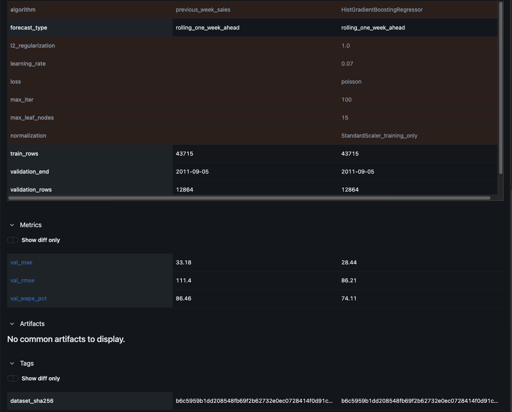
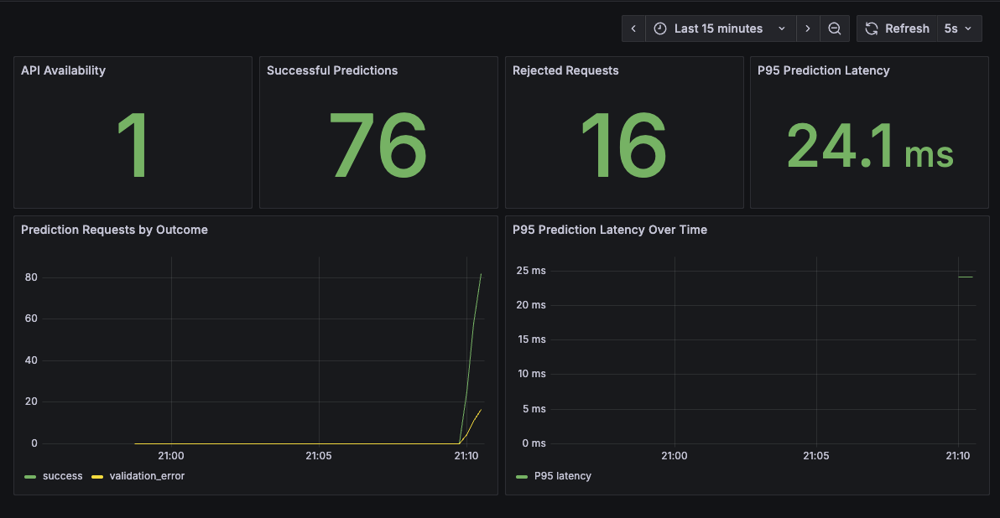

# Empirical results and validation trace

All reported results are directly supported by the original local run audits preserved under `evidence/` and the screenshots captured from MLflow, Airflow, and Grafana. They do not describe an AWS production deployment.

| Quality/provenance stage | Verified result |
|---|---:|
| UCI raw rows | 541,909 |
| Raw columns | 8 |
| Source ZIP SHA-256 | `f5385cbb54bbebf7196389109c6b0621faab0c304e3702548165e71c84aede8b` |
| Candidate paid-positive-sale rows | 530,104 |
| Curated physical merchandise rows | 527,758 |
| Excluded service/financial/voucher rows | 2,021 |
| Held ambiguous records | 325 |
| Four Dask partitions | Yes |
| Complete observed global product-weeks | 96,063 |
| Global distinct products | 3,782 |
| Global complete-week units | 5,241,234 |
| Full original vs Airflow SQL difference count | **0** |
| UK merchandise transactions | 484,004 |
| UK observed product-weeks | 93,608 |
| UK products present during complete weeks | 3,777 |
| Products eligible using development-period history | 1,608 |
| Missing product-weeks imputed after first observation | 15,910 |
| Model-ready rows | 75,875 |
| Model development / final holdout rows | 56,579 / 19,296 |

**Model comparison** (lower is better):

| Metric | Development validation: baseline | Development validation: ML | Final 12-week test: baseline | Final 12-week test: ML |
|---|---:|---:|---:|---:|
| MAE (units) | 33.183 | 28.443 | 39.838 | 35.038 |
| RMSE (units) | 111.449 | 86.211 | 123.250 | 106.444 |
| WAPE (%) | 86.457 | 74.109 | 77.424 | 68.096 |

The ML model reduced final-test MAE by 12.05%. No holdout data was used to choose hyperparameters. Re-evaluation as part of automated weekly retraining was not performed. The observed test WAPE signals substantial remaining predictive error, especially under heterogeneous product demand.

## Captured local execution evidence

**Airflow — nine-task DAG execution**: all ETL, SQL-loading, feature, model-training, and artifact-validation tasks reported success.

**MLflow — development validation comparison**: parameter and metric values match the saved development audit. The MLflow registry and original local artifact are not bundled in this public code repository.

**Prometheus and Grafana — active monitoring**: the dashboard displayed API availability `1`, cumulative successes `76`, cumulative invalid rejections `16`, and a displayed P95 of `24.1 ms`. The experiment intentionally replayed 75 successful and 15 invalid requests; these are cumulative counters including earlier manual tests, **not a production traffic benchmark**.

## Measurement boundaries

A Dask step reported 0.32 seconds on the local machine, with no comparator, cluster-scaling trial, or repeated confidence interval. Zero-filled unobserved weeks were interpreted as zero recorded sales, not verified inventory availability. The holiday model excluded region-specific holidays and did not contain any nationwide flagged holidays in the final 12 weeks. No external replication, real-time retail stream, AWS live model endpoint, or drift assessment was undertaken.
